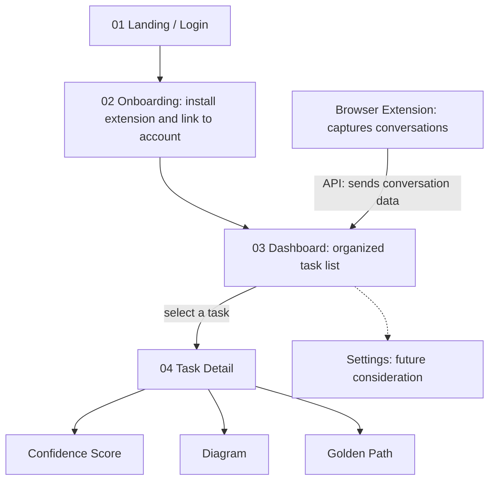

# Thoughts

**Turn long AI chats into a clear, organized list of tasks.**

Thoughts is a browser extension plus a website. The extension captures a student's AI conversations in the background. The website turns them into an organized task list, with a confidence score, a concept diagram, and a recommended path to completion for each task.

> **Status:** Early development. Nothing below is built unless marked otherwise. See the [Roadmap](#roadmap).

---

## The Problem

Long AI conversations are hard to use after the fact:

- Important ideas get buried in walls of text.
- It's rarely clear what the actual next steps are.
- It's hard to tell well-supported answers from guesses.
- Finding an earlier chat means scrolling through endless messages.

## The Solution

Thoughts has two parts that share one backend:

1. **Browser extension (the core of the product):** captures conversations in the background, with a visible on/off switch.
2. **Website:** a dashboard that turns captured conversations into tasks, and a detail view for each task.

---

## User Flow

### Pages and components

| # | Name | Purpose |
|---|---|---|
| 01 | **Landing / Login** | Product introduction and secure account access |
| 02 | **Onboarding** | Install the extension and link it to your account |
| 03 | **Dashboard** | Turns conversation data into an organized task list (search, filter, sort, empty state) |
| 04 | **Task Detail** | A focused view of one task derived from a conversation |
| - | **Browser Extension** | Lives outside the website. Captures conversations in the background (capture on/off) |
| - | **Settings** *(future)* | Manage account and captured data (pause, resume, delete) |

### Task Detail sections

- **Confidence Score:** how certain Thoughts is about the task. The score is *estimated* from the text (hedging, specificity, citations). It is not a measurement of the original AI's internal certainty, and the UI will say so.
- **Diagram:** visualizes the concepts in the task and how they relate.
- **Golden Path:** the recommended steps to complete the task.

---

## Privacy and Consent

This product captures conversations, so privacy is a core feature, not an add-on.

- The extension shows a clear **Capture on / Capture off** state at all times.
- Users can **pause, resume, and delete** their captured data. *(Proposed for the MVP, even though Settings is a future page.)*
- Capture state is owned by the backend, so the extension and the website always agree.
- Open question: who can see a student's data (only the student, or also instructors)? To be decided before any real users.

---

## Proposed Tech Stack

> Nothing here is final. Confirm as a team before building.

| Layer | Proposed choice | Notes |
|---|---|---|
| Extension | Manifest V3 (JavaScript/TypeScript) | Reads the supported AI site's page and sends it to the API |
| Website | React or Next.js | Landing, login, dashboard, task detail |
| Backend API | FastAPI (Python) or Node | One API shared by the
