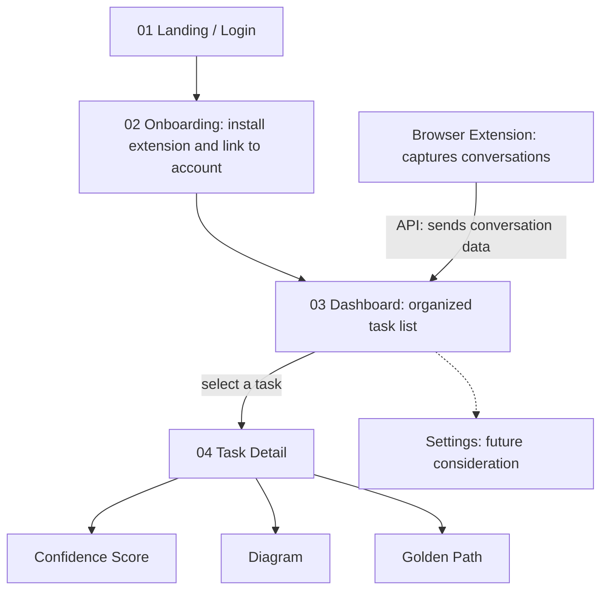

# Thoughts

**Turn long AI chats into a clear, organized list of tasks.**

Thoughts is a browser extension plus a website. The extension captures a student's AI conversations in the background. The website turns them into an organized task list, with a confidence score, a concept diagram, and a recommended path to completion for each task.

> **Status:** Early development. Nothing below is built unless marked otherwise. See the [Roadmap](#roadmap).

---

## The Problem

Long AI conversations are hard to use after the fact:

- Important ideas get buried in walls of text.
- It's rarely clear what the actual next steps are.
- It's hard to tell well-supported answers from guesses.
- Finding an earlier chat means scrolling through endless messages.

## The Solution

Thoughts has two parts that share one backend:

1. **Browser extension (the core of the product):** captures conversations in the background, with a visible on/off switch.
2. **Website:** a dashboard that turns captured conversations into tasks, and a detail view for each task.

---

## User Flow



### Pages and components

| # | Name | Purpose |
|---|---|---|
| 01 | **Landing / Login** | Product introduction and secure account access |
| 02 | **Onboarding** | Install the extension and link it to your account |
| 03 | **Dashboard** | Turns conversation data into an organized task list (search, filter, sort, empty state) |
| 04 | **Task Detail** | A focused view of one task derived from a conversation |
| - | **Browser Extension** | Lives outside the website. Captures conversations in the background (capture on/off) |
| - | **Settings** *(future)* | Manage account and captured data (pause, resume, delete) |

### Task Detail sections

- **Confidence Score:** how certain Thoughts is about the task. The score is *estimated* from the text (hedging, specificity, citations). It is not a measurement of the original AI's internal certainty, and the UI will say so.
- **Diagram:** visualizes the concepts in the task and how they relate.
- **Golden Path:** the recommended steps to complete the task.

---

## Privacy and Consent

This product captures conversations, so privacy is a core feature, not an add-on.

- The extension shows a clear **Capture on / Capture off** state at all times.
- Users can **pause, resume, and delete** their captured data. *(Proposed for the MVP, even though Settings is a future page.)*
- Capture state is owned by the backend, so the extension and the website always agree.
- Open question: who can see a student's data (only the student, or also instructors)? To be decided before any real users.

---

## Tech Stack

| Layer | Choice | Notes |
|---|---|---|
| Extension | Manifest V3 (TypeScript) | Reads the supported AI site's page and sends it to the backend. Never holds any AI key |
| Website + API | Next.js (TypeScript) on **Vercel** | One codebase and one deploy for the pages and the API routes |
| Database | Postgres (for example Neon or Supabase, via the Vercel marketplace) | Accounts, conversations, tasks. Final choice TBD |
| Auth | Provider-managed (for example Supabase Auth or Auth.js) | Avoid building login from scratch. Final choice TBD |
| AI analysis | **Azure OpenAI**, called only from the backend | One shared club key, stored only in Vercel environment variables |

### AI provider rules

- **Only the backend talks to Azure.** The extension and website call our API, never Azure directly.
- **One shared key.** It lives in the Vercel dashboard (and in the local `.env` of whoever needs real Azure calls in development). Teammates share it privately, never through the repo, issues, or AI chat prompts.
- **Mock by default.** Real Azure calls are opt-in so one person's bug can't use up the shared quota.
- **Protect the quota.** Cap conversation length, limit calls per minute, and cache results so reopening a task doesn't re-run analysis.
- If the key is ever committed, treat it as compromised and have it regenerated. Deleting the commit does not undo the exposure.

### Environment variables

`.env.example` (fake values, safe to commit):

```
ANALYSIS_PROVIDER=mock          # mock | azure
AZURE_OPENAI_ENDPOINT=https://your-resource.openai.azure.com/
AZURE_OPENAI_DEPLOYMENT=your-deployment-name
AZURE_OPENAI_API_KEY=replace-me
API_BASE_URL=http://localhost:3000
```

---

## How It Works

1. The user signs up and installs the extension (Onboarding).
2. The extension is **paired** with the account, for example with a one-time code the user pastes into the extension. *(Proposed.)*
3. With capture on, the extension sends conversation data to the backend.
4. The backend returns immediately with a "processing" status, then analyzes the conversation and produces **tasks**, each with a confidence score, diagram data, and golden path steps. This keeps slow Azure calls from hitting
