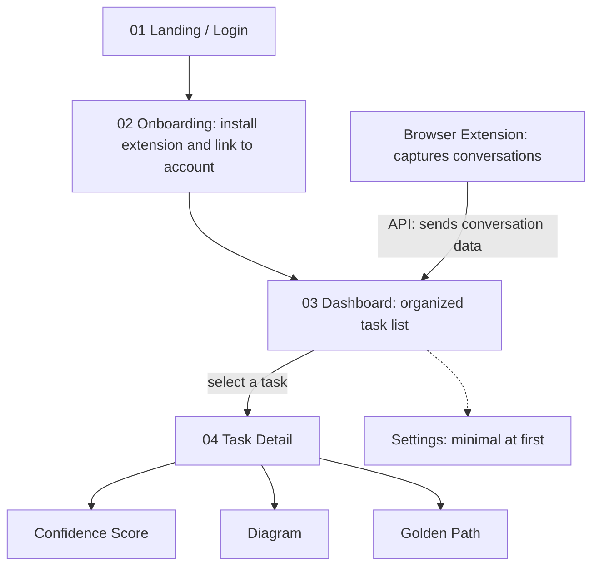

# Thoughts

**Turn long AI chats into a clear, organized list of tasks.**

Thoughts is a browser extension plus a website. The extension captures a student's AI conversations in the background. The website turns them into an organized task list. Each task has a confidence score, a concept diagram, and a recommended path to completion.

> **Status:** Early development. Nothing below is built unless marked otherwise. See the [Roadmap](#roadmap).

---

## The Main Thing

**The extension's capture-to-task pipeline, working end to end for one AI site.**

```
Extension reads a chat → sends it to our API → backend creates a task → a page shows it
```

Everything else (login, dashboard polish, diagram, settings) is an upgrade to this chain. Build the thin version first, even if it is ugly. If this chain works, we have a real product. Anything not on this path goes in [Parked Ideas](#parked-ideas) until it works.

---

## The Problem

Long AI conversations are hard to use after the fact:

- Important ideas get buried in walls of text.
- It's rarely clear what the actual next steps are.
- Finding an earlier chat means scrolling through endless messages.

## The Solution

Two parts that share one backend:

1. **Browser extension (the core of the product):** captures conversations in the background, with a visible on/off switch.
2. **Website:** a dashboard that turns captured conversations into tasks, and a detail view for each task.

---

## Brand

| Color | Name | Hex | Use |
|---|---|---|---|
| ⬛ | **True Black** | `#000000` | Text, nav, primary buttons, dark surfaces |
| 🟨 | **Rich Gold** | `#C9A227` | Accents, highlights, confidence bar, key actions |
| ⬜ | White / light gray | `#FFFFFF` / `#F5F5F5` | Backgrounds and cards |

```css
:root {
  --color-black: #000000;
  --color-gold: #C9A227;
  --color-white: #FFFFFF;
  --color-surface: #F5F5F5;
}
```

- Gold on black reads well (about 8.7:1 contrast). **Gold on white does not** (about 2.4:1), so on light backgrounds use black text and use gold only for fills, borders, and bars. Put text on a gold fill in black.
- Define colors once as design tokens (CSS variables or the Tailwind theme), never hard-coded per component.
- The wireframes are low-fidelity grayscale. Brand colors are applied on top of them.

---

## User Flow



### Screens

Wireframes (Figma Make: *Create sitemap for Thoughts*): https://www.figma.com/make/FXmFSs33K9YHYyUOkDvA8I/Create-sitemap-for-Thoughts

| # | Screen | Status | Purpose |
|---|---|---|---|
| 01 | **Dashboard** | Wireframed | "Your tasks": search, filter, sort, task rows with confidence badge and last-updated |
| 02 | **Dashboard / Empty state** | Wireframed | First-use state with a "Set up extension" button |
| 03 | **Task Detail** | Wireframed | Back link, title, Confidence Score, Diagram, Golden Path |
| - | Landing / Login | Not wireframed | Product intro and account access |
| - | Onboarding | Not wireframed | Install the extension and pair it with the account |
| - | Extension popup | Not wireframed | Capture on/off and status |
| - | Settings | Not wireframed | Pause, resume, delete captured data |

The header on every page shows a **Capture on / off** pill.

### Task Detail sections

- **Confidence Score:** *how clearly this task was identified.* It is Thoughts' estimate of how well it extracted the task from the conversation (for example, whether the goal and next steps were clearly stated). It is not a measure of whether the original AI's answer was correct. The UI shows a band (High, Medium, Low) with a one-line reason.
- **Diagram:** a visual overview of the concepts in the task and how they connect.
- **Golden Path:** a numbered recommended sequence. Each step has a short title and a one-line description.

---

## Privacy and Consent

This product captures conversations, so privacy is a core feature.

- The extension shows a clear **Capture on / off** state at all times.
- Users can pause, resume, and delete their captured data. *(Proposed for the MVP.)*
- The backend owns the capture state so the extension and website always agree.
- Open question: who can see a student's data (only the student, or also instructors)? Decide before any real users.

---

## Tech Stack

| Layer | Choice | Notes |
|---|---|---|
| Extension | Manifest V3 (TypeScript) | Reads the supported AI site and sends it to the backend. Never holds any AI key |
| Website + API | Next.js (TypeScript) on **Vercel** | One codebase and one deploy for pages and API routes |
| Database | Postgres (for example Neon or Supabase) | Final choice TBD |
| Auth | Provider-managed (for example Supabase Auth or Auth.js) | Final choice TBD |
| AI analysis | **Azure OpenAI**, called only from the backend | One shared club key, stored only in Vercel environment variables |

### AI provider rules

- **Only the backend talks to Azure.** The extension and website call our API.
- **One shared key.** It lives in the Vercel dashboard and in the local `.env` of whoever needs real Azure calls. Share it privately, never through the repo, issues, or AI chat prompts.
- **Mock by default.** Real Azure calls are opt-in so one person's bug can't use up the shared quota.
- **Protect the quota.** Cap conversation length, limit calls per minute, cache results.
- If the key is ever committed, treat it as compromised and have it regenerated.

### Environment variables

`.env.example` (fake values, safe to commit):

```
ANALYSIS_PROVIDER=mock          # mock | azure
AZURE_OPENAI_ENDPOINT=https://your-resource.openai.azure.com/
AZURE_OPENAI_DEPLOYMENT=your-deployment-name
AZURE_OPENAI_API_KEY=replace-me
API_BASE_URL=http://localhost:3000
```

---

## How It Works

1. The user signs up and installs the extension.
2. The extension is paired with the account, for example with a one-time code. *(Proposed.)*
3. With capture on, the extension sends conversation data to the backend.
4. The backend returns immediately with a `processing` status, then analyzes the conversation and creates tasks. This keeps slow Azure calls under Vercel's function time limits.
5. The dashboard lists tasks and shows a processing state until analysis finishes.
6. The user opens a task to see Confidence Score, Diagram, and Golden Path.

### Data model (draft)

```
User
 └── Conversation (source site, captured_at, raw turns)
      └── Task (title, summary, status, created_at, updated_at)
           ├── confidence (score, band, reason)
           ├── diagram (nodes, edges)
           └── golden_path (ordered steps: title, description)
```

Task status is one of `processing`, `ready`, or `failed`. The confidence band is derived from the score.

### Browser security note

The extension and website call the backend from different origins, so CORS must be configured on the API routes. This is a common "works in curl, fails in the browser" problem.

---

## Parked Ideas

Good ideas we are **not** building yet. Revisit once the main pipeline works. Do not delete items; move them to the Roadmap when ready.

**Product and UI**
- [ ] Link each task back to its source conversation (for example "From: Copilot chat, May 20") so the confidence reason is believable
- [ ] Decide what a task is: a to-do (add done/status) or an insight (consider renaming)
- [ ] Define real Filter options (Processing, Ready, Failed) to match backend statuses
- [ ] Design missing states: task processing, failed analysis, header when Capture is off
- [ ] Wireframe landing/login, onboarding with pairing, and the extension popup
- [ ] Minimal Settings page (pause, resume, delete), or hide the tab until it exists
- [ ] Diagram section (simple hub-and-spoke is enough to start)

**Analysis**
- [ ] Golden Path prompt must require steps specific to the conversation, not generic filler
- [ ] A second score for how trustworthy the original AI answer was (the original README idea)
- [ ] Original README ideas: templates (Project Plan, Study Guide, Decision Matrix), priority buckets (Highly Important, Moderate, Do It Later), key-phrase detection
- [ ] Handle very long conversations (chunk, then merge)
- [ ] Define how captured chats are parsed from the page and what to do when the AI site changes its layout
- [ ] Use structured/JSON output from Azure OpenAI and validate it

**Platform**
- [ ] Confirm exact Azure service, deployment name, and quota
- [ ] Decide when conversations are analyzed (immediately, in batches, or on demand)
- [ ] Support more AI sites after the first one works
- [ ] API contract document (written agreement of request/response shapes), if the team wants it later
- [ ] License

---

## Open Decisions

- [x] AI provider: Azure OpenAI, backend only
- [x] Hosting: Vercel
- [x] Brand colors: Rich Gold `#C9A227` and True Black `#000000`
- [ ] **Which AI site does the extension capture first?** (Exactly one.)
- [ ] Database and auth providers
- [ ] Who can see captured data

---

## Planned Project Structure

> Proposed. Adjust as the build progresses.

```
thoughts/
├── extension/        # Browser extension (capture + pairing)
├── web/              # Next.js app: website pages and API routes
├── docs/
│   ├── PLAN.md       # Current decisions, what's done, what's next
│   └── sample_chat.txt
├── AGENTS.md         # Standing context for Cursor and other AI tools
├── .env.example
└── README.md
```

The empty `frontend/` and `backend/` folders from the initial setup can be removed.

---

## Getting Started

> Setup steps will be filled in as the app is built.

```bash
gh repo clone UnitedAI-Projects/Thoughts
cd Thoughts
cp .env.example .env   # keep ANALYSIS_PROVIDER=mock unless you need real Azure calls
```

### Keep secrets out of GitHub

API keys must **never** be committed, even in a private repo. Keys live in a local `.env` (listed in `.gitignore`) and in the Vercel dashboard. Keep `*.db` files out of git too.

---

## Roadmap

**MVP path (what we demo):**

- [x] Create repo
- [x] Wireframes: Dashboard, Empty state, Task Detail
- [ ] Next.js app deployed on Vercel
- [ ] Three screens built with mock data and brand colors
- [ ] Mock analysis provider returning sample tasks
- [ ] Extension captures one AI site and sends data to the backend
- [ ] Login and extension pairing
- [ ] Task Detail shows Confidence Score and Golden Path from real data
- [ ] Real analysis through Azure OpenAI
- [ ] Capture on/off and delete data

**After the MVP:** see [Parked Ideas](#parked-ideas).

---

## Team

| Name | Area |
|---|---|
| Will Cook | TBD |
| Justin Martinez | TBD |
| Fernando Hernandez | TBD |
| Piero Canales | TBD |

Suggested split: **extension**, **backend and API**, **website UI**, **analysis and AI prompt**. Each person works in their own folder and branch.

---

## Workflow for Teammates

We plan in Claude and build in Cursor.

1. **Plan:** decisions and task specs go into `docs/PLAN.md`.
2. **Build:** give Cursor one small, scoped task at a time. Check that Cursor is pointed at the **thoughts** repo first.
3. **Share:** commit and push so everyone's tools see the same plan. Vercel gives each branch its own preview URL.

```bash
git pull
git checkout -b your-name/feature
# ...make your changes...
git add <files>                   # avoid `git add .` to prevent committing secrets
git commit -m "Describe what you did"
git push -u origin your-name/feature
# then open a pull request
```

---

## License

To be decided.
